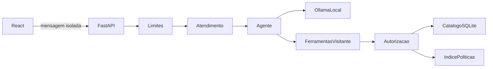

# Atendimento web local — Fase 5

O navegador conversa somente com FastAPI. O serviço de atendimento reutiliza o agente e as cinco ferramentas de leitura da Fase 4. Ollama permanece acessível exclusivamente pelo adaptador do backend, com URL de loopback, sem proxy de ambiente, redirecionamento ou inferência remota.

## Publicação explícita e revogável

O banco operacional e o índice continuam privados. A existência de um registro não autoriza sua publicação. `PublicacaoArquivo` lê `.local/publicacao.json`, com versão 1 e mapa de referência interna para SHA-256 da tupla fonte, texto e referência. Ausência equivale a nenhuma evidência autorizada; arquivo inválido falha de forma fechada. O exemplo em `docs/exemplos/publicacao-visitante.example.json` está vazio.

O operador deve revisar as fontes localmente e decidir quais evidências comerciais ou trechos de políticas podem aparecer ao visitante. A CLI `python -m emporio_ia.revisar_publicacao consultar_categorias '{}'` apenas produz referências e fingerprints; não publica, não grava arquivo e não substitui a revisão do conteúdo. Insira manualmente somente as entradas aprovadas no arquivo privado. Não aprove um documento inteiro por conveniência. A revisão deve ser repetida quando o texto ou a referência mudar. Dados pessoais, clientes e pedidos não pertencem às ferramentas disponíveis, mesmo que alguém tente inserir suas referências no manifesto.

O filtro aplica-se antes de enviar resultados ao modelo. A resposta final revalida a autorização atual para permitir revogação durante a consulta. A aplicação reconstrói respostas a partir das evidências aprovadas; não publica prosa livre do modelo. Referências HTTP têm somente tipo, título seguro e página documental real, sem caminhos, fingerprints, identificadores internos ou pontuação BM25.

O manifesto aceita `ambiente` opcional (`desenvolvimento` ou `teste`); quando informado, deve corresponder à configuração da aplicação. Uma liberação exclusiva de desenvolvimento não pode ser usada em outro ambiente. Quando há resultados privados e nenhum foi aprovado, a consulta retorna `503 publicacao_indisponivel`, em vez de aparentar ausência no catálogo. Falha de acesso ao banco retorna `503 consulta_indisponivel`.

Saudações, agradecimentos e despedidas isoladas retornam estado `social`, sem carregar manifesto, consultar banco ou chamar Ollama. Perguntas comerciais, inclusive acompanhadas de saudação, percorrem o agente e a validação integral de evidências. `buscar_produtos` permite omitir `termo` para listar produtos; pesquisa nome e categoria com normalização de acentos e plural, preservando a leitura do banco original. A recuperação de seleção omitida ou consulta vazia usa apenas as cinco ferramentas existentes, com argumentos validados e os mesmos limites de etapas, chamadas, contexto e tempo. Não recupera falhas de infraestrutura nem aceita JSON inválido ou evidências inexistentes.

`GET /api/atendimento/disponibilidade` inclui `publicacao` e um identificador curto `configuracao`, calculado sobre ambiente, caminhos resolvidos, URL e modelo. Ele permite comparar a instância ativa com o diagnóstico local sem publicar caminhos ou conteúdo. `configurada` indica manifesto não vazio e válido; não comprova que todas as consultas possíveis estão liberadas.

## Contratos e limites

- `GET /api/saude`: processo da API; não mede inferência.
- `GET /api/atendimento/disponibilidade`: verifica metadados, instalação local e capacidade de ferramentas. `modelo=acessivel` não significa homologado; `homologacao=pendente` permanece explícito.
- `POST /api/atendimento/mensagens`: recebe exclusivamente `{"mensagem":"..."}`, até 1.000 caracteres. Retorna estado, resposta, referências e identificador aleatório da requisição. Não recebe histórico nem identidade do cliente.

São permitidos apenas peer de loopback, Host local e Origin explicitamente configurada quando presente. CORS permite GET/POST, sem credenciais. Não use proxy reverso nem exposição em rede: estes controles não implementam autenticação. A aplicação é destinada ao uso local com um processo Uvicorn.

Padrões configuráveis: 8.192 bytes por corpo, 10 segundos para leitura, 20 requisições por minuto por IP local nas rotas de atendimento (incluindo disponibilidade), uma consulta simultânea por processo, 120 segundos totais no agente, 5 segundos para disponibilidade e 130 segundos no cliente. Resposta HTTP até 16.000 caracteres e 20 referências. `429` inclui `Retry-After`; os erros públicos são estáveis e sanitizados. Cancelamento/desconexão encerra a tarefa assíncrona e libera a vaga; uma leitura SQLite já enviada a uma thread pode terminar normalmente, e a liberação da geração no servidor Ollama depende do fechamento da conexão.

## Interface e sessão

Componentes React separam cabeçalho, sugestões, área de mensagens e composição. O painel segue o padrão clássico de atendimento, sem barra lateral: saudação e respostas da loja à esquerda, cliente à direita, cabeçalho e rodapé fora da região de rolagem. O histórico reside apenas no estado React, limitado às 50 mensagens recentes e descartado ao recarregar ou iniciar nova conversa. Cada pergunta é independente para o agente. Somente a preferência visual é salva em `localStorage`; indisponibilidade desse armazenamento é tolerada.

Enter envia, Shift+Enter quebra linha e composição por IME não dispara envio. O visitante pode cancelar, tentar novamente ou iniciar nova conversa. Respostas tardias são descartadas. O log de mensagens anuncia atualizações e oferece retorno ao fim quando o visitante lê conteúdo anterior. Texto é renderizado como texto React, sem HTML ou Markdown executável. Fontes vêm exclusivamente da API.

Há temas claro/escuro, preferência inicial do sistema, foco visível, alvos de toque e layout móvel. O campo expande até 144 px; o hook `useAlturaVisivel` acompanha o Visual Viewport quando disponível, com fallback `100dvh` e áreas seguras no CSS. O SVG original é reutilizado na marca, nos avatares e no favicon. Não há streaming simulado, upload, login, pedidos ou suporte humano fictício.

## Validação e limites de confiança

Os testes automatizados usam fontes fictícias em diretórios temporários. A integração real HTTP pode executar uma pergunta pessoal bloqueada sem consultar dados privados nem exigir inferência. A homologação real usa Ollama com catálogo e políticas inteiramente sintéticos, separados dos arquivos operacionais.

A inferência real apresentou falhas de protocolo e corte no limite de geração em parte dos cenários. As recusas continuam seguras, mas o atendimento não está homologado para uso real. Metadados acessíveis, testes simulados aprovados e build bem-sucedido não resolvem essa pendência.

Referências: [CORS no FastAPI](https://fastapi.tiangolo.com/tutorial/cors/), [log acessível W3C](https://www.w3.org/WAI/WCAG21/Techniques/aria/ARIA23), [protocolo Ollama](https://docs.ollama.com/api/chat) e [controle de pensamento do Qwen3](https://huggingface.co/Qwen/Qwen3-4B). O adaptador usa `think=false` e `/no_think` no modelo Qwen3, mantendo validação estrita das ferramentas e finalização estruturada.
