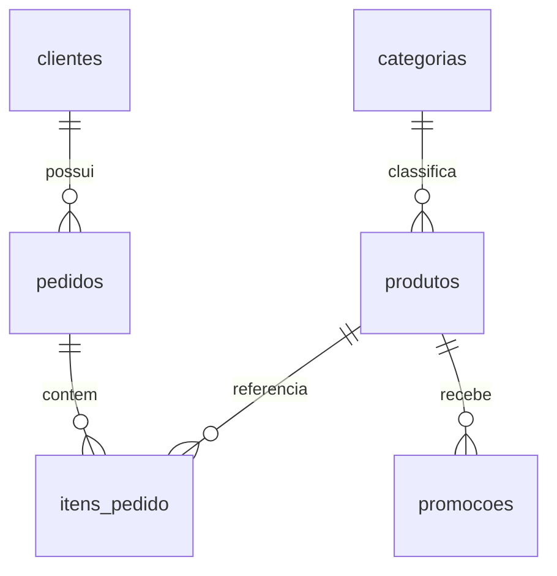

# Contrato dos dados operacionais — Fase 2

Este documento registra somente estrutura e agregados da inspeção local. Não contém amostras de registros nem dados pessoais. O PDF permaneceu sem processamento.

## Fontes e tipos

Os arquivos fornecidos têm o prefixo `desafio_tecnico_ai_eng - ` seguido dos nomes abaixo. O localizador também aceita o nome canônico, exigindo exatamente uma fonte candidata por conjunto. Todos usam vírgula e UTF-8.

| Arquivo           | Registros | Cabeçalhos reais e tipos                                                                                                                                                                                                                |
| ----------------- | --------: | --------------------------------------------------------------------------------------------------------------------------------------------------------------------------------------------------------------------------------------- |
| `categories.csv`  |         9 | `category_id`: inteiro positivo; `name`, `description`: texto obrigatório                                                                                                                                                               |
| `customers.csv`   |        50 | `customer_id`: inteiro positivo; `name`, `phone`, `email`, `city`: texto obrigatório                                                                                                                                                    |
| `products.csv`    |        65 | `product_id`, `category_id`: inteiros positivos; `price_brl`: decimal monetário; `name`, `description`, `status`, `specs`: texto obrigatório; `stock_quantity`: inteiro não negativo; `created_at`: data ISO                            |
| `orders.csv`      |        20 | `order_id`, `customer_id`: inteiros positivos; `order_date`: data ISO; `status`, `payment_method`: texto obrigatório; `total_brl`: decimal monetário; `tracking_code`, `notes`: texto opcional; `estimated_delivery`: data ISO opcional |
| `order_items.csv` |        22 | `order_id`, `product_id`, `quantity`: inteiros positivos                                                                                                                                                                                |
| `promotions.csv`  |        25 | `promotion_id`, `product_id`: inteiros positivos; `discount_percent`: decimal entre 0 e 100; `description`: texto obrigatório; `is_active`: indicador 0 ou 1                                                                            |

Cabeçalhos são obrigatórios, mesmo para colunas cujo valor pode estar ausente. Ordem de colunas não importa; cabeçalhos extras, repetidos ou ausentes causam erro. Não inferimos tipos pelo conteúdo de uma linha isolada. `specs` é preservado como texto, sem inventar um esquema JSON. Telefones são texto, sem conversão numérica. Email é preservado sem regra de unicidade ou validação sintática não exigida pela origem.

## Agregados e inconsistências

- Identificadores principais são distintos nos seis conjuntos; os pares pedido/produto também são distintos.
- Todas as cinco relações abaixo foram confirmadas sem órfãos.
- Há 49 emails distintos para 50 clientes. Não deduplicar clientes por email nem impor `UNIQUE(email)`.
- Em pedidos, 12 valores de rastreamento e 12 de entrega estimada estão vazios; 16 observações estão vazias. São ausências legítimas e tornam-se `NULL`.
- Campos monetários não apresentam negativos ou valores não finitos. A inspeção encontrou no máximo uma casa decimal nos valores da origem; o contrato aceita até duas, sem arredondar.
- Todas as datas preenchidas são datas ISO sem hora. Não há fuso a inferir.
- Produtos apresentam estados `active` (62), `discontinued` (2) e `coming_soon` (1). O estado original é preservado; disponibilidade exige `active` e quantidade positiva. Outros estados futuros serão conservados sem serem considerados disponíveis.
- Há quatro promoções marcadas como ativas e 21 inativas. Não existem datas de início ou término; não é possível determinar expiração.
- Itens não possuem preço unitário nem identificador próprio. Não derivar preço histórico a partir do catálogo atual nem inferir regras de desconto para conciliar totais.

## Modelagem

| Tabela         | Chave primária            | Relações e restrições principais                                                               |
| -------------- | ------------------------- | ---------------------------------------------------------------------------------------------- |
| `categorias`   | `identificador`           | Nome e descrição não vazios                                                                    |
| `clientes`     | `identificador`           | Contatos locais; email sem unicidade                                                           |
| `produtos`     | `identificador`           | `categoria_id → categorias`; `preco_centavos ≥ 0`; estoque não negativo; `nome_busca` derivado |
| `pedidos`      | `identificador`           | `cliente_id → clientes`; `total_centavos ≥ 0`; rastreamento, entrega e observações anuláveis   |
| `itens_pedido` | `(pedido_id, produto_id)` | Referências a pedidos e produtos; quantidade positiva                                          |
| `promocoes`    | `identificador`           | `produto_id → produtos`; desconto inteiro entre 0 e 10000; indicador 0/1                       |

Cada conexão ativa `PRAGMA foreign_keys = ON` antes da transação. Tabelas são `STRICT`. Datas são validadas no domínio e armazenadas como texto ISO. Preços e totais são inteiros em centavos. Desconto é inteiro em pontos-base percentuais; nenhum desconto é aplicado nesta fase.

Índices: categoria e preço de produtos apoiam os filtros; cliente de pedidos, produto de itens e produto de promoções apoiam referências e consultas. As chaves primárias já indexam identificadores e a consulta de itens por pedido. A busca por trecho do nome faz varredura, adequada ao volume atual; não há índice inútil para essa operação.

## Importação e consulta

O esquema completo está em `backend/src/emporio_ia/infraestrutura/esquema.py`; os mapeamentos externos estão em `formatos_csv.py`. A ordem é categorias, clientes, produtos, pedidos, itens e promoções. Toda substituição é atômica; a limpeza segue a ordem inversa das dependências.

O importador rejeita qualquer conjunto vazio. Isso evita apagar dados por arquivo truncado, mas exige revisão explícita caso uma origem futura legitimamente não contenha promoções ou pedidos. Não há descarte automático, preenchimento inventado, soma de linhas duplicadas ou correção silenciosa. Textos passam por trim e normalização Unicode NFC; conteúdo original no CSV permanece intacto.

O catálogo oferece filtros e consultas tipadas. Consultas inexistentes retornam `None` ou lista vazia, nunca valores inventados. Pedidos exigem identificador do cliente junto ao identificador do pedido e retornam uma projeção reduzida; o serviço não autentica o chamador. Promoções retornam indicador ativo e `validade_temporal = indisponivel`. Todos esses serviços são internos e não estão ligados a rotas HTTP.

## Segurança

Fontes e banco são confidenciais, ignorados e locais. Resumos apresentam apenas contagens. Erros de campos incluem conjunto, linha e coluna, sem conteúdo do registro ou caminho absoluto. O importador não gera arquivos temporários de registros; o journal transacional do SQLite permanece junto da base ignorada. Fixtures são sintéticas e não consultam `data/`.
