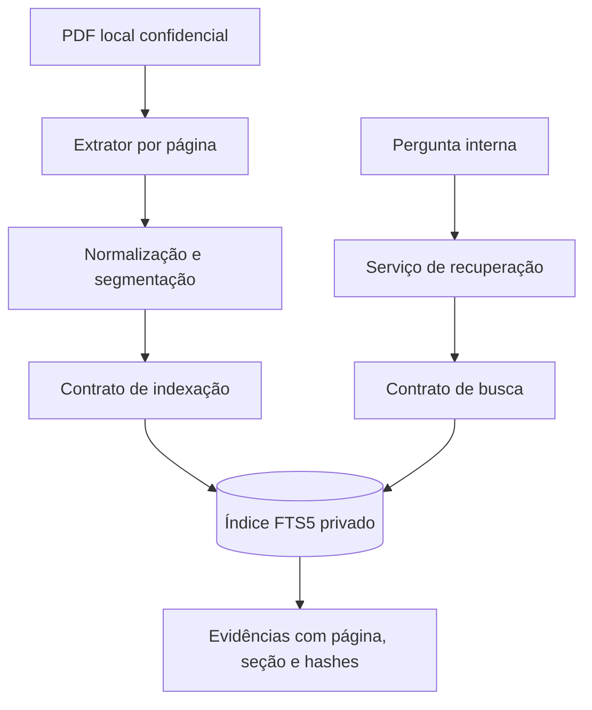

# Recuperação documental — Fase 3

## Escopo e limites de confiança

Recuperar evidências do PDF local de políticas, preservando a origem. O mecanismo não gera respostas, interpreta regras comerciais, consulta conhecimento externo ou executa instruções do texto. Não há LLM, Ollama, embeddings, chat, Function Calling ou endpoint documental. Textos e índices são confidenciais.

## Componentes

| Camada         | Componente                                                                     | Responsabilidade                                                                     |
| -------------- | ------------------------------------------------------------------------------ | ------------------------------------------------------------------------------------ |
| Domínio        | `DocumentoPoliticas`, `PaginaDocumento`, `TrechoDocumento`, `TrechoRecuperado` | Representar documento, origem, fragmentos e evidências sem depender de PDF ou SQLite |
| Domínio        | `segmentacao.py`                                                               | Normalização textual controlada, títulos heurísticos e divisão com offsets estáveis  |
| Domínio        | `busca_documental.py`                                                          | Termos, acentos, plurais simples, termos comuns e validação da pergunta              |
| Aplicação      | `IndexadorPoliticas`                                                           | Orquestrar extração, segmentação e substituição pelo contrato do índice              |
| Aplicação      | `ServicoRecuperacao`                                                           | Validar pergunta e limite e solicitar evidências pelo contrato                       |
| Infraestrutura | `ExtratorPdf`                                                                  | Ler bytes locais e extrair texto por página com pypdf                                |
| Infraestrutura | `RepositorioTrechos`                                                           | Persistir conteúdo e consultar FTS5 com SQL parametrizado                            |
| Entrada local  | `indexar_politicas.py`                                                         | Compor adaptadores e apresentar somente resumo operacional                           |

A aplicação depende de protocolos. O adaptador documental reutiliza apenas o gerenciamento transacional genérico de conexões SQLite; não usa consultas, tabelas ou repositórios operacionais. Erros de persistência são traduzidos para mensagens documentais sanitizadas.

## Extração

`pypdf` 6.21.4, sob BSD-3-Clause, é a única dependência nova. O arquivo é lido em modo binário, sem ser modificado. O SHA-256 é calculado sobre os mesmos bytes processados em memória, evitando que o hash represente uma leitura diferente do conteúdo extraído. Não se escreve cópia do PDF ou texto temporário.

Usamos `extract_text(extraction_mode="layout")` com leitura estrita. Na inspeção estrutural do arquivo local, a extração padrão produzia muitas palavras em linhas separadas; o modo de layout preservou melhor linhas e separadores de parágrafos. Isso não garante interpretação semântica perfeita, especialmente para tabelas, colunas e cabeçalhos.

Normalização NFC, espaços horizontais consecutivos reduzidos e no máximo uma linha vazia entre blocos. Pontuação, acentos, valores e hífens são preservados. Não há correção de regras, números, texto hifenizado ou caracteres supostamente errados.

Páginas começam em 1 e mantêm a numeração física do PDF. Páginas isoladas sem texto permanecem no documento, sem produzir fragmentos. Documento inteiro sem texto gera erro explícito de ausência de OCR. PDFs criptografados, corrompidos ou ilegíveis não geram um índice parcial. Há limites locais de 20 MiB e 500 páginas; esses limites não garantem contenção de memória para todo PDF possível. OCR ou outro parser exigirá avaliação e autorização próprias.

## Segmentação

Tamanho padrão: 1200 caracteres, configurável entre 200 e 10000. Nenhum trecho cruza páginas. São priorizados parágrafos; linhas que aparentam títulos numerados ou em maiúsculas introduzem nova seção. A seção é uma inferência textual, não uma estrutura semântica certificada; pode estar ausente ou representar um item numerado. A última seção identificada pode continuar nas páginas seguintes.

Parágrafos longos são divididos em limites heurísticos de frases após pontuação e espaço. Abreviações e formatos complexos podem limitar a qualidade dessa heurística. Não há sobreposição, remoção de frases, corte de palavras ou truncamento silencioso. Uma unidade que não cabe no limite gera erro para que a configuração seja revista.

Cada trecho armazena identificador, documento, página, seção quando disponível, texto, ordem global, início, fim e SHA-256 do texto. Início e fim se referem à página normalizada, não a posições binárias no PDF. O identificador é um hash determinístico do documento, página, offsets e hash do conteúdo. Ele permanece estável para a mesma origem normalizada e estratégia. O hash binário do PDF acompanha cada evidência para identificar a versão exata.

## Persistência e atualização

O índice padrão é `.local/politicas.sqlite3`, separado de `.local/emporio.sqlite3`. Ambos são confidenciais e ignorados. `application_id` distingue a identidade documental e `user_version` identifica a versão do esquema. Um banco não vazio sem essa identidade é recusado antes de qualquer DDL ou limpeza; isso protege o banco operacional mesmo quando o adaptador recebe um caminho errado diretamente.

Tabelas:

- `documentos`: identificador lógico, hash do PDF, quantidade de páginas e assinatura do processamento.
- `trechos`: texto e metadados, chave estável única, ordem única por documento e referência estrangeira ao documento.
- `busca_trechos`: FTS5 com termos derivados do texto e da seção, ligada aos trechos por `rowid`. O texto original normalizado permanece separado para citação verificável.

A assinatura inclui versão do pypdf, modo de extração, versões da segmentação e da busca, e tamanho máximo. `alterado` indica mudança de hash da origem ou assinatura em relação ao índice anterior. A CLI reconstrói mesmo quando esse indicador é falso; a idempotência é por conteúdo e identificadores, não por arquivo SQLite binariamente idêntico.

DDL, remoção, inserção de metadados, trechos e FTS ficam em uma única transação `BEGIN IMMEDIATE`. A ordem de remoção respeita as referências. Erros provocam rollback e preservam o índice anterior. Chaves estrangeiras estão ativas em cada conexão. Não usamos `executescript` nem desativamos integridade para reconstruir. Leituras usam `mode=ro`, `query_only` e uma transação consistente. Um índice ausente não é criado por uma busca.

O índice representa um único documento de políticas, substituído integralmente. Não há merge, histórico de versões ou atualização automática por observação do arquivo. Reexecute a CLI após alterar a origem, as configurações ou a estratégia. Hashes permitem detectar a versão, mas o serviço de busca não relê o PDF a cada pergunta para detectar obsolescência.

## Busca e rejeição de resultados

Perguntas não vazias, até 500 caracteres e 32 termos distintos significativos. Limite de 1 a 20 resultados, padrão 5. Normalização Unicode sem acentos e sem distinção de caixa; tokenização alfanumérica; remoção de lista explícita de palavras comuns; plurais simples `ões/ães → ão`, `ais → al` e alguns `s` finais. Essas regras são heurísticas e podem deixar variantes sem correspondência ou aproximar palavras diferentes. Não há stemming linguístico completo.

O FTS5 usa `unicode61 remove_diacritics 2`. Os termos indexados incluem a seção e o corpo, preservando frequência para BM25. O serviço compõe um `AND` de termos literais, sem aceitar operadores FTS, SQL ou sintaxe de usuário. Todos os valores são parâmetros SQL. O corpo devolvido permanece exatamente o texto do trecho, e a seção é metadado adicional de contexto.

Rejeição conservadora: todos os termos significativos devem estar presentes no trecho ou na seção; uma correspondência parcial não é promovida a evidência. Perguntas somente genéricas, numéricas, pontuação ou sem correspondência produzem lista vazia. Isso pode rejeitar perguntas respondíveis quando seus termos estão em blocos diferentes, usam sinônimos ou outra flexão. Lista vazia significa ausência de evidência recuperada, não prova inexistência da política.

Resultados são ordenados por BM25 crescente, depois página e ordem, com remoção de conteúdo repetido por hash antes de aplicar o limite final. Ocorrências repetidas podem ser preservadas no índice com suas páginas distintas, mas a busca retorna uma ocorrência representativa por conteúdo. BM25 é uma pontuação lexical dependente do corpus, nunca probabilidade de certeza. Não se aplica um limiar numérico sem calibração nem se declara compreensão semântica.

## Segurança e operação

`data/` e `.local/` já eram ignorados antes da implementação. Nenhum texto derivado é salvo fora do índice privado. Não há chamadas externas, telemetria ou credenciais. Avisos e logs do parser pypdf são suprimidos para evitar reprodução de objetos documentais; falhas são traduzidas para mensagens estáveis. Entidades com texto usam representação que não inclui campos confidenciais. Isso não substitui cuidado ao serializar ou registrar retornos internos.

O banco não é criptografado e depende das permissões da conta e do volume. Não compartilhe o índice, exports ou backups. O futuro agente deverá tratar o texto como dados não confiáveis e nunca dar autoridade a instruções recuperadas. A API desta fase continua expondo apenas saúde, além da documentação OpenAPI padrão.

## Testes

Os PDFs de teste são criados com pypdf em diretórios temporários a partir de texto fictício. Nenhum teste lê o documento privado. Há testes de extração, erro, numeração, normalização, cobertura de segmentos, estabilidade, alteração, rollback, idempotência, acentos, plurais, relevância, ausência de evidência, limite, SQL/FTS parametrizado, privacidade, Git ignore e preservação do banco operacional.

Execução: `backend/.venv/Scripts/python.exe -m pytest backend/testes/documentos`. Os resultados da execução completa, incluindo regressões anteriores, estão no [relatório da Fase 3](../relatorios/fase3.md).

## Referências

- [Extração textual com pypdf e limitações do formato PDF](https://pypdf.readthedocs.io/en/stable/user/extract-text.html).
- [SQLite FTS5: tokenização, MATCH e BM25](https://www.sqlite.org/fts5.html).
