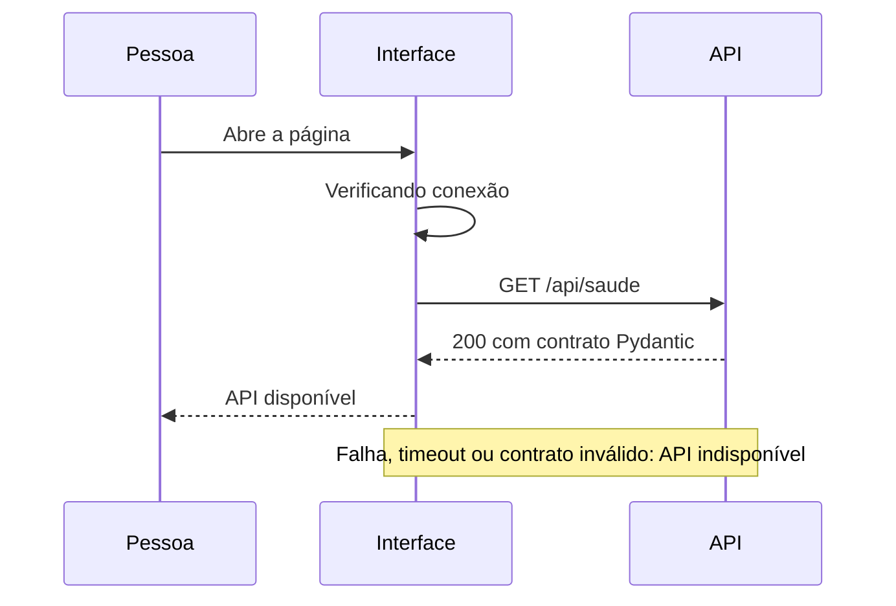

# Visão geral da arquitetura

Atualização da Fase 5: o [atendimento web local](atendimento-web.md) acrescenta interface de chat, autorização explícita de evidências e HTTP sob limites. As restrições históricas da Fase 4 abaixo descrevem o ponto de partida; agora existe chat visual. Não há exposição de clientes/pedidos nem autenticação. A homologação real permanece parcial, conforme o relatório da Fase 5.

## Objetivos

A Fase 6 acrescenta homologação optativa com Ollama real e servidor de fontes fictícias para reprodução pelo navegador. O [relatório](../relatorios/fase6.md) registra falhas ainda impeditivas de homologação integral; não houve substituição de arquitetura ou modelo.

Estabelecer uma fundação pequena, tipada, testável e local. Separar apresentação, transporte HTTP e configuração sem criar classes ou camadas sem comportamento concreto.

## Responsabilidades atuais

- Frontend: apresentação acessível, estado de conexão e nova tentativa. Componentes não conhecem detalhes do transporte.
- Serviços HTTP: URL por ambiente, cancelamento, timeout, verificação de status e validação do contrato recebido.
- API: rota de saúde e modelos Pydantic. A dependência de configuração pode ser substituída nos testes.
- Composição: fábrica FastAPI registra rotas, CORS explícito e tratamento básico de erros. Exceções não devolvem parâmetros ou conteúdo interno.
- Configuração: variáveis tipadas e validadas, com nomes e versão centralizados.
- Domínio: entidades operacionais, filtros, invariantes de conversão e exceções sem dependências de FastAPI ou SQLite.
- Aplicação: serviços internos de catálogo e pedidos dependentes de contratos de repositório.
- Infraestrutura: importador CSV transacional, tabelas SQLite e adaptadores de consulta somente para leitura. SQL permanece fora das rotas.
- Recuperação documental: contratos próprios de extração/indexação/busca, entidades documentais no domínio e adaptadores locais `pypdf`/FTS5. Não usa os repositórios nem o banco operacional.
- Agente interno: contrato de modelo, adaptador Ollama e registro explícito de cinco ferramentas somente de leitura. A aplicação controla orçamento, valida argumentos, reúne evidências e renderiza fatos/citações sem texto comercial livre do modelo. Não há ferramentas pessoais ou atendimento HTTP.

## Fluxo

Não há acesso a `data/` nesse fluxo. OpenAPI permanece disponível em `/docs` e `/openapi.json`.

## Evolução planejada

Na Fase 2, domínio, aplicação e infraestrutura estão implementados para os dados operacionais. O importador usa as conversões do domínio e grava um snapshot completo de seis conjuntos dentro de uma única transação. Os serviços internos dependem de contratos implementados pelos repositórios SQLite. A API permanece sem ligação com esses serviços. O [contrato dos dados](dados-operacionais.md) detalha modelagem e limitações.

Consultas estruturadas usam `csv`, `Decimal`, centavos inteiros e SQL parametrizado. As conexões de consulta abrem o banco em modo somente leitura e ativam chaves estrangeiras. A validação de identidade e autorização para pedidos ainda deverá anteceder qualquer exposição: filtrar pelo identificador de cliente não autentica o chamador.

A Fase 4 implementa o adaptador Ollama local e a orquestração Python controlada, documentados na [arquitetura do agente](agente-local.md). O modelo solicita ferramentas nativas e seleciona evidências; a aplicação valida e produz a resposta restrita. Não há SQL, comandos, arquivos ou dados pessoais expostos como ferramentas. O funcionamento com um servidor/modelo real e seu desempenho ainda não foram homologados: os testes usam simuladores.

A Fase 3 implementa extração local por página com `pypdf` (BSD-3-Clause), fragmentos com offsets e hashes, e FTS5 em banco separado. A aplicação depende de contratos de extração e índice; o mecanismo retorna evidências, sem produzir respostas. A estratégia de rejeição exige todos os termos significativos, com limitações lexicais explícitas. Consulte [recuperação documental](recuperacao-documental.md).

Documentos e resultados são tratados como dados não confiáveis no ciclo do agente, separados das instruções por papéis do protocolo. O recuperador continua apenas extraindo e recuperando texto; a nova aplicação de orquestração reutiliza esse contrato sem executar instruções contidas nas políticas.

## Segurança e privacidade

`/data/`, segredos, bancos e logs são ignorados. Nenhum dado real integra testes ou documentação. Não há telemetria nem serviços pagos. O frontend não recebe credenciais. CORS permite apenas origens explícitas e não substitui autenticação. O comando documentado desativa logs de acesso, que poderiam registrar parâmetros de requisição.

Os erros retornam mensagens estáveis e genéricas. Observabilidade estruturada e sanitização de logs devem ser definidas antes das integrações com dados pessoais. Não há publicação automática ou deploy nesta etapa.

## Limitações conhecidas

A saúde comprova somente que a API responde; não verifica modelos, bancos ou documentos. A disponibilidade é consultada na abertura e por nova tentativa após erro, sem monitoramento contínuo. Testes de interface usam JSDOM; verificação visual em navegador e tecnologias assistivas complementa esses testes. Persistência existe apenas localmente; não há identidade de cliente, criptografia do SQLite ou exposição HTTP dos serviços operacionais. Promoções não têm período de validade na origem e itens de pedido não têm preço histórico.

FTS5 não compreende sinônimos ou contexto semântico. PDFs não possuem estrutura semântica garantida: títulos e frases são heurísticos, e documentos digitalizados não são suportados sem OCR autorizado. Nenhuma rota HTTP oferece políticas ou trechos. O índice é atualizado explicitamente pelo comando local, com versão da origem em cada evidência.

A geração é extrativa e por templates, sem validação semântica universal de linguagem natural. O registro fechado e a renderização determinística limitam o efeito de prompt injection, mas não provam que o modelo sempre escolherá fontes relevantes. Perguntas não compartilham histórico e a CLI não persiste transcrições. A instalação local do Ollama é uma fronteira de confiança e deve operar sem inferência em nuvem.
