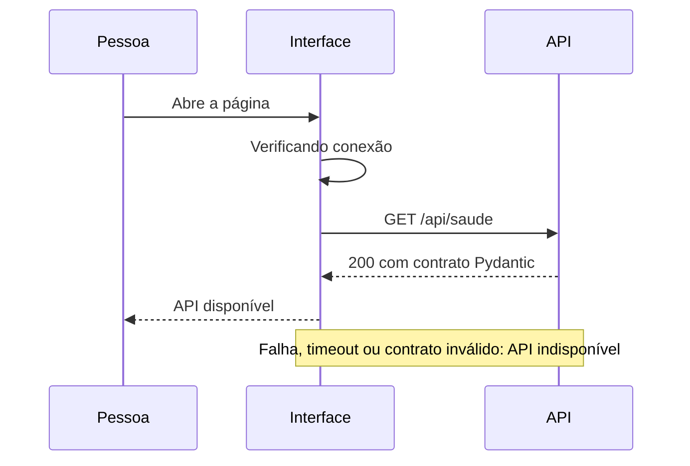

# Visão geral da arquitetura

## Objetivos

Estabelecer uma fundação pequena, tipada, testável e local. Separar apresentação, transporte HTTP e configuração sem criar classes ou camadas sem comportamento concreto.

## Responsabilidades atuais

- Frontend: apresentação acessível, estado de conexão e nova tentativa. Componentes não conhecem detalhes do transporte.
- Serviços HTTP: URL por ambiente, cancelamento, timeout, verificação de status e validação do contrato recebido.
- API: rota de saúde e modelos Pydantic. A dependência de configuração pode ser substituída nos testes.
- Composição: fábrica FastAPI registra rotas, CORS explícito e tratamento básico de erros. Exceções não devolvem parâmetros ou conteúdo interno.
- Configuração: variáveis tipadas e validadas, com nomes e versão centralizados.

## Fluxo

Não há acesso a `data/` nesse fluxo. OpenAPI permanece disponível em `/docs` e `/openapi.json`.

## Evolução planejada

Quando necessárias, a camada de domínio conterá regras e entidades, e a aplicação conterá casos de uso e contratos. Adaptadores de infraestrutura implementarão os contratos. Rotas e componentes não executarão regras de negócio diretamente.

Consultas estruturadas poderão usar importação local com `csv`, `Decimal` para valores monetários e SQLite com consultas parametrizadas. A validação de identidade e autorização para pedidos deverá anteceder a exposição de informações pessoais.

Ollama será um adaptador local, sujeito à capacidade do computador. A orquestração Python controlará quais ferramentas podem ser chamadas e validará argumentos e resultados. O modelo não terá acesso irrestrito a arquivos ou SQL. Seu uso, modelo e desempenho ainda não foram validados.

A recuperação futura de políticas exigirá extração de PDF com licença adequada, fragmentos e referências verificáveis. Documentos e respostas de ferramentas serão tratados como dados não confiáveis, com controles contra instruções maliciosas. Essas estratégias são propostas, sem implementação na Fase 1.

## Segurança e privacidade

`/data/`, segredos, bancos e logs são ignorados. Nenhum dado real integra testes ou documentação. Não há telemetria nem serviços pagos. O frontend não recebe credenciais. CORS permite apenas origens explícitas e não substitui autenticação. O comando documentado desativa logs de acesso, que poderiam registrar parâmetros de requisição.

Os erros retornam mensagens estáveis e genéricas. Observabilidade estruturada e sanitização de logs devem ser definidas antes das integrações com dados pessoais. Não há publicação automática ou deploy nesta etapa.

## Limitações conhecidas

A saúde comprova somente que a API responde; não verifica modelos, bancos ou documentos. A disponibilidade é consultada na abertura e por nova tentativa após erro, sem monitoramento contínuo. Testes de interface usam JSDOM; verificação visual em navegador e tecnologias assistivas complementa esses testes. Não há contratos de negócio, persistência nem identidade de cliente.
